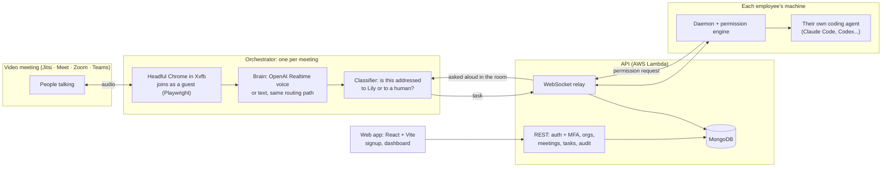

# Lily: an AI teammate for your meetings


> **Portfolio note.** I designed and built Lily as a startup project. It's not finished
> or deployed, but the core works end to end on a laptop: a real browser join of a
> Jitsi meeting, live classification of who is talking to whom, and a question
> answered by a teammate's own Claude Code. The project status at the bottom says
> exactly what is and isn't done.



**Stack:** TypeScript monorepo (npm workspaces) · Node.js · React, Vite, Tailwind · AWS Lambda, API Gateway (REST + WebSocket), EC2, SES, Secrets Manager · MongoDB · Playwright · OpenAI Realtime · zod · Vitest (295 tests) · Docker.

### Interesting problems in this codebase

- **Never obeying an instruction meant for a person.** "John, finish the auth refactor" has to be logged silently, while "Sarah, how does login work?" goes to Sarah's agent. That distinction is the product, and it has its own classification test suite.
- **Permissions that only the right human can grant.** When an agent wants to run a command, Lily asks the room, and only the spoken "yes" of the agent's owner counts. Refusals, timeouts and backstops are all tested.
- **Joining meetings without vendor SDKs.** Zoom, Teams and Meet have no usable bot APIs, so Lily joins through the real web client in headful Chrome inside a virtual framebuffer, with one adapter and a small driver per platform.
- **Local mode that's a real test, not a mock universe.** A stage switch picks *providers* (secrets, email, WebSocket, compute), never business logic. Locally, a shim reproduces API Gateway's exact WebSocket contract, so the same handlers run everywhere.
- **Privacy by construction.** No audio, video, full transcripts or code is ever stored. That's enforced by MongoDB TTL indexes, a runtime write guard and a custom ESLint rule.

---

An AI teammate who joins your video meetings as a participant. She listens, speaks,
knows who everyone is, and dispatches work to each employee's **own** local coding
agent — Claude Code, Codex, Cursor, whatever they already use — running on their
machine, with their repos and their permissions.

One bot in the meeting, N agents behind it.

```
Manager:  "John, make sure you finish the auth refactor by Sunday."
          → Lily says nothing. Logs it silently for John to confirm at the end.

Manager:  "Sarah, how does the login flow work?"
          → Dispatched to Sarah's Claude Code. It greps her repo. Lily answers aloud.

Sarah's agent wants to run `npm test`
          → Lily asks the room. Only Sarah's spoken yes counts.
```

The distinction in the first two lines is the product. She must never act on an
instruction addressed to a human.

---

## What runs where

| | |
|---|---|
| `packages/shared` | Stage system, config, provider contracts, the zod wire protocol |
| `api` | Lambda handlers — REST + WebSocket, auth, Mongo access |
| `orchestrator` | Per-meeting bot: meeting adapters, classification, permission relay |
| `daemon` | Runs on the employee's machine, drives their coding agent |
| `web` | Marketing site, signup, dashboard (Vite + React + Tailwind) |
| `emails` | SES templates |

### Three stages, one code path

`local` · `dev` · `prod`. Stage selects **providers**, never business logic — if you
find yourself writing `if (stage === 'prod')` inside a handler, the branch belongs in
a provider. That is what makes local development a real test rather than a parallel
mock universe.

| Concern | `local` | `dev` / `prod` |
|---|---|---|
| HTTP API | local server | API Gateway HTTP API |
| WebSocket | shim reproducing the API Gateway contract | API Gateway WebSocket API |
| Secrets | `.env.local` | Secrets Manager + KMS |
| Email | real `.eml` written to `tmp/mail/` | SES |
| Orchestrator | child process, or Docker for browser joins | EC2, one per meeting |
| Mongo | Docker, single-node replica set | Atlas |

`sam local` has no WebSocket support, and the daemon connection *is* the product — so
the shim reproduces API Gateway's exact contract (`connectionId`, `$connect`/
`$disconnect`, route keys on `$request.body.type`, 410 on stale connections) and
invokes the same handlers.

---

## Getting started

```bash
npm install
npm run typecheck && npm test
```

Then follow **[TESTING.md](TESTING.md)** — it walks from a green build to your own
Claude Code answering a question in a live meeting. Every command in it was run
before it was written down.

Quick tour:

```bash
npm run db:up && npm run db:verify   # Mongo + 13 checks against it
npm run dev -w web                   # marketing site → :5173
node orchestrator/dist/main.js       # simulated meeting room → :4100
node daemon/dist/index.js doctor     # diagnose a daemon install
```

No OpenAI key needed for any of that — the text brain runs the identical
classification and dispatch path as the voice brain.

---

## How meetings are joined

**Not vendor SDKs.** Lily joins through the **web client in a real browser**, as a
guest, like a human. One adapter covers Jitsi, Google Meet, Zoom and Teams; adding a
platform is a small driver holding URLs, a selector table and a click order.

The SDK route was tried and abandoned: Zoom requires manual review plus a native C++
Linux SDK, Teams requires `Microsoft.Skype.Bots.Media` which is Windows-only .NET with
no Node binding, and Google Meet has no bot API at any price.

This needs Linux — Xvfb, PulseAudio, real Google Chrome. On Windows and macOS, use the
container:

```bash
docker compose --profile browser build orchestrator
docker compose --profile browser run --rm --no-deps \
  -e LILY_MEETING_PLATFORM=jitsi \
  -e LILY_MEETING_URL="https://meet.jit.si/your-room" \
  orchestrator node orchestrator/dist/main.js
```

Chrome runs **headful** inside a virtual framebuffer — headless is detected by Meet
and Zoom. PulseAudio needs no sound hardware, because every device here is a null sink.

> Google's and Zoom's terms restrict automated access, and their UIs change without
> notice. That is an accepted product risk — see `orchestrator/README.md`. **Jitsi** is
> open source, permits guests, and is the conflict-free first target.

---

## What this stores

Only what is needed to route work and to bill. **Never** meeting audio or video, full
transcripts, source code, file contents, or agent output.

Task text and the meeting summary are the only derived content, retained because the
summary email and the dashboard cannot exist without them. Per-org retention, default
90 days, hard-delete endpoint.

Enforced three ways: TTL indexes so the database deletes on schedule whether or not
our code runs, a runtime guard on write paths, and an ESLint rule at author time.
See **[SECURITY.md](SECURITY.md)**.

Lily holds no credentials to any employee system. "Book a meeting" is a task dispatched
to that employee's own agent, performed through *their* MCP servers with *their*
credentials.

---

## Deploying

The AWS shape is designed (API Gateway HTTP + WebSocket APIs, Lambda, one EC2
instance per meeting, Secrets Manager, SES, Atlas), and every provider has its AWS
implementation behind the stage switch. The infrastructure-as-code to stand it up is
not written yet — see *Project status* below.

---

## Project status

This is **not finished**. Working and verified: the classification and routing core,
the daemon and its permission engine, the browser meeting adapter (a real Jitsi join),
the marketing site, the data layer, and the local REST API — auth with MFA and step-up,
orgs, team and invites, `POST /daemon/enroll`, meetings, tasks, audit and owner
analytics. The dashboard runs against it on real data (`VITE_LILY_API_MODE` defaults to
`http`; set it to `mock` for the in-memory demo).

In progress or absent: SAM infrastructure and anything deployed, Google sign-in,
WebAuthn, and billing beyond recording the org's intent — no payment processor is
wired, so subscription lifecycle events do not exist and the analytics endpoint reports
the figures that depend on them as unavailable rather than guessing. `SECURITY.md` has a
"known gaps" section listing what is specified but not yet true — read it before
assuming a control exists.
